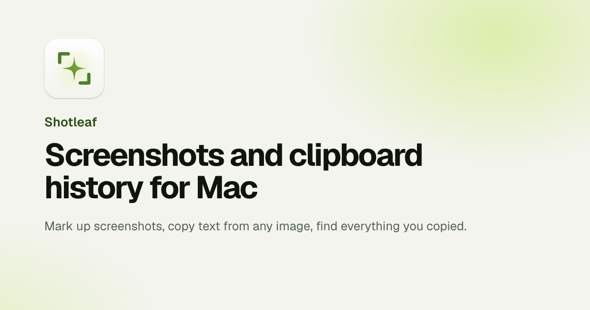
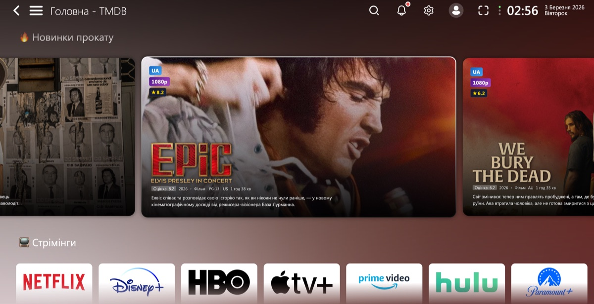

### Hi, I'm Oleksii (Syvyj) 👋

An independent developer from Ukraine. I build small, useful apps and tools and share them at [syvyj.dev](https://syvyj.dev). · [Українська ↓](#uk)

<table>
<tr>
<td width="50%" valign="top">

**[Shotleaf](https://github.com/Syvyj/shotleaf)**: screenshots, clipboard history, snippets and text completion for the Mac. A menu-bar app in Swift; free and open source. 
[Website](https://shotleaf.syvyj.dev) · [Download](https://github.com/Syvyj/shotleaf/releases/latest/download/Shotleaf.dmg)
</td>
<td width="50%" valign="top">

**[Likhtar](https://github.com/Syvyj/studios_4lampa)**: a custom home screen for the Lampa media app, with catalogues of streaming services from TMDB. 
[Install](https://github.com/Syvyj/studios_4lampa#readme)
</td>
</tr>
</table>

Also: [Phonebook](https://github.com/Syvyj/goit-react-hw-08) (React, Redux Toolkit) · [Watchcharm](https://github.com/Syvyj/team-04), a team landing page I led · [a restaurant landing page](https://github.com/Syvyj/restaurant-landing-page-html-css-js)

**Swift · SwiftUI · JavaScript · React · Python**

If my apps save you time, you can support them on [Ko-fi](https://ko-fi.com/syvyj) or [Buy Me a Coffee](https://buymeacoffee.com/syvyj). Write to me: hi@syvyj.dev

---

### Привіт, я Олексій (Syvyj) 👋

Незалежний розробник з України. Роблю невеликі корисні застосунки й інструменти і викладаю їх на [syvyj.dev](https://syvyj.dev). · [↑ English](#en)

<table>
<tr>
<td width="50%" valign="top">

**[Shotleaf](https://github.com/Syvyj/shotleaf)**: скріншоти, історія буфера обміну, сніпети й дописування тексту для Mac. Застосунок у рядку меню на Swift; безкоштовний і з відкритим кодом. 
[Сайт](https://shotleaf.syvyj.dev/uk/) · [Завантажити](https://github.com/Syvyj/shotleaf/releases/latest/download/Shotleaf.dmg)
</td>
<td width="50%" valign="top">

**[Ліхтар](https://github.com/Syvyj/studios_4lampa)**: кастомна головна сторінка для Lampa з каталогами стрімінгових сервісів із TMDB. 
[Встановити](https://github.com/Syvyj/studios_4lampa#readme)
</td>
</tr>
</table>

А ще: [Телефонна книга](https://github.com/Syvyj/goit-react-hw-08) (React, Redux Toolkit) · [Watchcharm](https://github.com/Syvyj/team-04), командний лендинг, де я був тімлідом · [лендинг ресторану](https://github.com/Syvyj/restaurant-landing-page-html-css-js)

**Swift · SwiftUI · JavaScript · React · Python**

Якщо мої застосунки заощаджують вам час, підтримати можна на [Ko-fi](https://ko-fi.com/syvyj), [Buy Me a Coffee](https://buymeacoffee.com/syvyj) чи в [банку Monobank](https://send.monobank.ua/jar/5juJPj142b). Пишіть: hi@syvyj.dev
